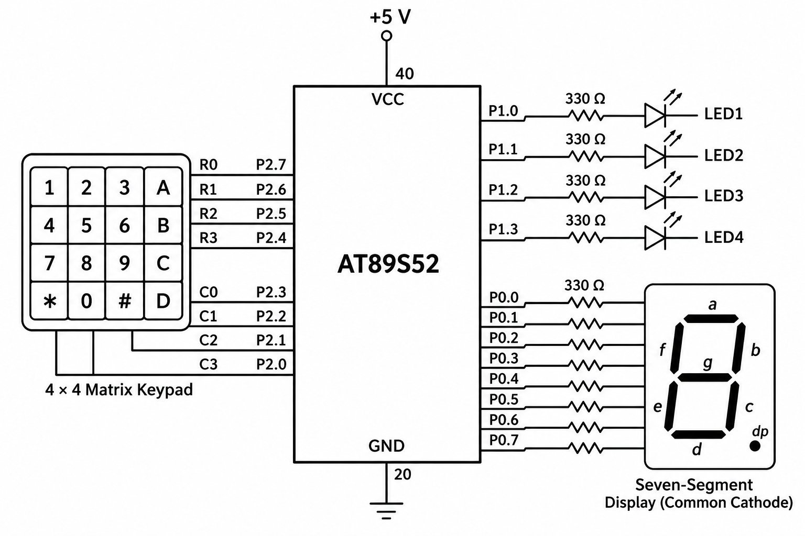

# CAT4 – Human-Machine Interface using Matrix Keypad, LEDs, and Seven-Segment Display

## EXP
CAT4

## DATE
03/08/2026 (Week 3)

## NAME OF EXP
Human-Machine Interface using Matrix Keypad, LEDs, and Seven-Segment Display

## HARDWARE SETUP / PLATFORM

- **Development Board:** 8051 Universal Development Board
- **Microcontroller:** AT89S52
- **Programming Environment:** Keil µVision
- **Operating Voltage:** +5V
- **Input Device:** 4×4 Matrix Keypad
- **Display Device:** Seven-Segment Display
- **Output Components:** Four LEDs

### Pin Configuration

| Component | Port / Pins |
|---|---|
| Keypad Rows | P2.7, P2.6, P2.5, P2.4 |
| Keypad Columns | P2.3, P2.2, P2.1, P2.0 |
| Seven-Segment Display | P0.0–P0.7 |
| LED1 | P1.0 |
| LED2 | P1.1 |
| LED3 | P1.2 |
| LED4 | P1.3 |

## TASK NO

### Activity: Human-Machine Interface using Matrix Keypad, LEDs, and Seven-Segment Display

Design a simple embedded user interface in which:

- The matrix keypad acts as an input device.
- The seven-segment display provides visual feedback.
- The LEDs indicate different operating modes.

Whenever a valid key is pressed:
1. Display the key value on the seven-segment display.
2. Execute the corresponding LED function.

## Circuit Diagram

## Core Logic / Pseudocode / Code Base

### 1. Core Logic

The program uses a 4×4 matrix keypad to receive user input. The keypad is scanned using GPIO pins of the AT89S52 microcontroller.

The detected keypad position is used to:
- Display a corresponding hexadecimal value on the seven-segment display.
- Execute the associated LED operation.

The seven-segment display is controlled through Port 0, while the four LEDs are controlled through Port 1.

### 2. Keypad Scanning

The `keypad_scan()` function performs row-column scanning.

- Four rows are connected to P2.7–P2.4.
- Four columns are connected to P2.3–P2.0.
- One row is activated at a time.
- The column inputs are checked to identify a pressed key.
- The function returns a value from 0 to 15 representing the detected keypad position.

### 3. Seven-Segment Display

The `display_digit()` function uses a switch-case statement to select the corresponding segment pattern.

The output is written directly to Port 0.

The lookup table supports values from 0 to 15, including hexadecimal representations A–F.

### 4. LED Control Modes

The `led_control()` function selects the LED operation based on the detected keypad index.

| Keypad Index | LED Operation |
|---|---|
| 0 | LED1 ON |
| 1 | LED2 ON |
| 2 | LED3 ON |
| 3 | LED4 ON |
| 4 | Running LED pattern |
| 5 | Alternating LED pattern |
| 6 | Binary counter |
| 7 | All LEDs blink |
| 8 | All LEDs OFF |
| Other values | All LEDs OFF |

### 5. LED Pattern Functions

The following functions are implemented in `patterns.c`:

**runningPattern()**

Turns ON the LEDs sequentially using Port 1.

**alternatingPattern()**

Alternates between the patterns `1010` and `0101`.

**binaryCounter()**

Displays a four-bit binary count from 0 to 15 using the four LEDs.

**flash()**

Alternates between all LEDs ON (`1111`) and all LEDs OFF (`0000`).

### 6. Delay Implementation

The `delay()` function is implemented using nested software loops.

It provides the time interval required for the LED patterns.

### 7. Source Files

| File | Description |
|---|---|
| `mini.c` | Main program containing keypad scanning, seven-segment display and LED control |
| `patterns.c` | LED pattern generation functions |
| `patterns.h` | LED pattern function declarations |
| `delay.c` | Software delay implementation |
| `delay.h` | Delay function declaration |
| `Day3Task1.uvproj` | Keil project configuration |

## Implementation Notes

- The keypad scanning function returns row-column position indices from 0 to 15.
- The seven-segment display shows the returned index using a lookup table.
- The LED control function implements operations for indices 0–8.
- The current implementation uses software polling and delay loops.
- The evaluation sheet's physical-key-to-operation mapping and reset behaviour are not fully implemented by the current source code.
- No Arduino APIs, HAL libraries or RTOS services are used.

## INFERENCE

The experiment demonstrates the implementation of a basic human-machine interface using the AT89S52 microcontroller.

A 4×4 matrix keypad is used to receive user input, while a seven-segment display provides visual feedback. Four LEDs are controlled through GPIO pins to demonstrate different output patterns.

The experiment provides practical understanding of matrix keypad scanning, GPIO configuration, seven-segment display interfacing, LED pattern generation and embedded C programming.
