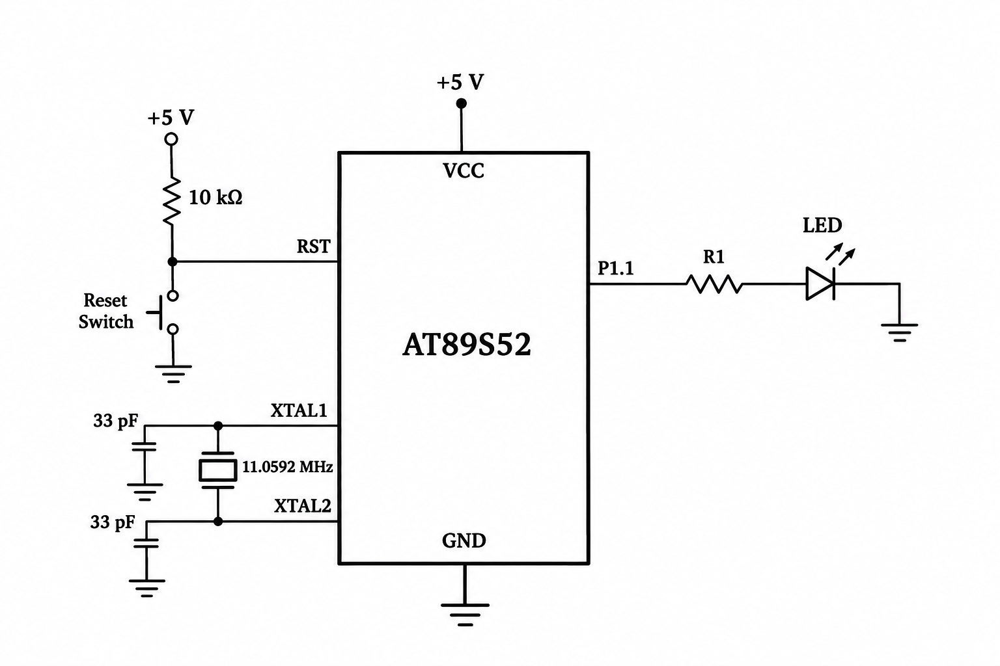

# CAT5 – Timer-Based LED Toggle Using Timer 0

## EXP
CAT5 – Task 1

## DATE
10/08/2026 (Week 4)

## NAME OF EXP
Hardware Timer and Interrupt-Based Timing for LED Fading, Pulse Generation, and Stepper Motor Control

## HARDWARE SETUP / PLATFORM

- **Development Board:** 8051 Universal Development Board
- **Microcontroller:** AT89S52
- **Programming Environment:** Keil µVision
- **Crystal Frequency:** 11.0592 MHz
- **Operating Voltage:** +5V
- **Output Component:** External LED
- **LED GPIO Pin:** P1.1
- **Timer Used:** Timer 0
- **Timer Configuration:** Mode 1 (16-bit timer)

## TASK NO

### Task 1: LED Toggle Using Hardware Timer

Configure Timer 0 to generate a precise periodic timing event. Use the timer to create a software time base and toggle an LED every 1 second. Verify the generated timing using an oscilloscope.

The implementation uses the hardware timer as the time reference for LED control.

## Circuit Diagram

## Core Logic / Pseudocode / Code Base

### 1. Core Logic

The program uses Timer 0 of the AT89S52 microcontroller to generate periodic timing events.

- Timer 0 is configured in Mode 1 (16-bit mode).
- The timer registers TH0 and TL0 are loaded with initial values.
- The timer is started using the TR0 control bit.
- The program continuously checks the TF0 overflow flag.
- When an overflow occurs, the flag is cleared and the timer is reloaded.
- A software counter tracks the number of timer overflows.
- Once the counter reaches 86, the LED connected to P1.1 is toggled.

### 2. Pseudocode

1. Start the program.
2. Configure Timer 0 in Mode 1.
3. Load TH0 with 0xE6.
4. Load TL0 with 0xCD.
5. Start Timer 0.
6. Continuously check the TF0 overflow flag.
7. If an overflow occurs:
   - Clear TF0.
   - Reload TH0 and TL0.
   - Increment the software counter.
8. If the counter reaches 86:
   - Reset the counter.
   - Toggle the LED connected to P1.1.
9. Repeat continuously.

### 3. Source Files

| File | Description |
|---|---|
| `timer_led.c` | Main program implementing Timer 0 configuration and LED toggling |
| `Day4Task1.uvproj` | Keil µVision project configuration |
| `STARTUP.A51` | 8051 startup assembly file |

### 4. Implementation

**timer_led.c**

The program includes `reg51.h` to access the 8051 hardware registers.

The LED is connected to P1.1 and is controlled using the `sbit` declaration.

Timer 0 is configured using:

- `TMOD = 0x01` to select Mode 1.
- `TH0 = 0xE6` to load the higher timer byte.
- `TL0 = 0xCD` to load the lower timer byte.
- `TR0 = 1` to start the timer.

The `timer0_check()` function checks the TF0 overflow flag through polling.

Whenever an overflow occurs, the timer is reloaded and the software counter is incremented. After 86 overflows, the LED state is toggled.

### 5. Programming Approach

- Bare-metal Embedded C programming.
- Direct access to 8051 timer registers.
- Timer 0 configured in 16-bit Mode 1.
- Timer overflow flag polling.
- Software counter for tracking timer overflows.
- GPIO output control through P1.1.
- No Arduino APIs, HAL libraries or RTOS services.

## INFERENCE

The experiment demonstrates hardware timer configuration and GPIO control using the AT89S52 microcontroller.

Timer 0 is configured in 16-bit Mode 1 to generate periodic overflow events. The overflow flag is monitored through polling, and a software counter is used to determine when the LED should change state.

The experiment provides practical understanding of timer configuration, overflow monitoring, register-level programming and timer-based LED control.

## IMPLEMENTATION NOTE

The evaluation sheet specifies interrupt-driven timing and LED toggling at 1-second intervals. The submitted implementation uses Timer 0 overflow polling instead of a timer interrupt service routine.

The timer is reloaded with 0xE6CD, and the LED is toggled after 86 overflow events. The actual output interval has not been experimentally verified using an oscilloscope.
