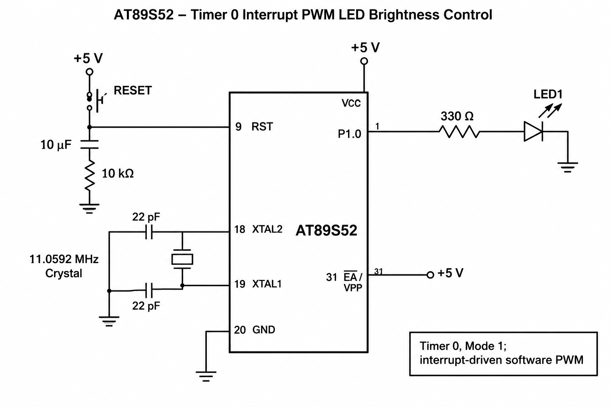

# CAT5 – Timer Interrupt-Based LED Fading Using Software PWM

## EXP
CAT5

## DATE
10/08/2026 (Week 4)

## NAME OF EXP
Hardware Timer and Interrupt-Based Timing for LED Fading

## HARDWARE SETUP / PLATFORM

- **Development Board:** 8051 Universal Development Board
- **Microcontroller:** AT89S52
- **Programming Environment:** Keil µVision
- **Operating Voltage:** +5V
- **Clock Frequency:** 11.0592 MHz (assumed)
- **Output Component:** LED
- **Output Port:** Port 1
- **LED Pin:** P1.0
- **Timer Used:** Timer 0
- **Timer Mode:** Mode 1 (16-bit timer)
- **Interrupt Used:** Timer 0 Overflow Interrupt

## TASK NO

### Task 2: LED Fading Using Software PWM

Using the timer interrupt developed in Task 1, generate a software PWM signal and gradually vary the duty cycle from 0% to 100% and back to 0%, producing a visible LED fading effect.

The implementation uses a hardware timer interrupt as the timing reference and software logic to control the LED brightness.

## Circuit Diagram

## Core Logic / Pseudocode / Code Base

### 1. Core Logic

The program implements LED brightness control using Software Pulse Width Modulation (PWM) on the AT89S52 microcontroller.

- Timer 0 is configured in Mode 1 (16-bit timer mode).
- Timer 0 generates periodic interrupts.
- The timer is reloaded inside the interrupt service routine.
- A counter variable tracks the PWM time interval.
- A duty cycle variable controls the ON duration of the LED.
- The duty cycle gradually decreases from 100% to 0% and then increases back to 100%.
- The LED is switched ON or OFF based on the comparison between the counter and duty cycle.

### 2. PWM Operation

Pulse Width Modulation controls LED brightness by varying the percentage of time the LED remains ON during each PWM cycle.

| Duty Cycle | LED Brightness |
|---|---|
| 0% | OFF |
| 25% | Dim |
| 50% | Medium |
| 75% | Bright |
| 100% | Fully ON |

The program continuously changes the duty cycle to produce a fading effect.

### 3. Timer Configuration

Timer 0 is configured using the TMOD register.

- `TMOD = 0x01` configures Timer 0 in Mode 1.
- `TH0 = 0xFC` and `TL0 = 0x66` load the initial timer count.
- The reload value is used to generate an approximately 1 ms timer interval, assuming an 11.0592 MHz crystal and a classic 12-clock 8051.
- `IE = 0x82` enables global interrupts and Timer 0 interrupts.
- `TR0 = 1` starts Timer 0.

### 4. PWM Generation

The interrupt service routine performs the following operations:

1. Reloads Timer 0.
2. Increments the counter variable.
3. Resets the counter after reaching 100.
4. Updates the duty cycle based on the direction flag.
5. Changes the direction when the duty cycle reaches 0% or 100%.
6. Compares the counter with the duty cycle to control the LED output.

### 5. Source Files

| File | Description |
|---|---|
| `ledfading.c` | Main program implementing Timer 0 interrupt and software PWM |
| `CAT5Task2.uvproj` | Keil project configuration file |
| `STARTUP.A51` | 8051 startup assembly file |
| `CAT5Task2.hex` | Generated HEX file for microcontroller programming |
| `circuit.png` | Circuit diagram showing the AT89S52 and LED connections |

### 6. Implementation

**ledfading.c**

The program uses the `reg51.h` header file to access the 8051 registers.

The `sbit` keyword is used to define the LED output on P1.0.

Three global variables are used:

- `count` maintains the PWM counter.
- `duty` stores the current duty cycle.
- `increasing` determines whether the duty cycle should increase or decrease.

Timer 0 is configured in 16-bit Mode 1 using the TMOD register.

The Timer 0 interrupt service routine is declared using `interrupt 1`. It reloads the timer, updates the PWM counter and adjusts the duty cycle.

The LED is controlled by comparing the counter value with the duty cycle.

The main function initializes the timer and enables interrupts. The infinite loop remains empty because the LED control is performed inside the interrupt service routine.

### 7. Programming Approach

- Bare-metal Embedded C programming.
- Direct register-level programming.
- Timer 0 configuration using the TMOD register.
- 16-bit timer operation.
- Interrupt-driven timing control.
- Software Pulse Width Modulation (PWM).
- Duty cycle variation for LED brightness control.
- No Arduino APIs, HAL libraries or RTOS services.

## INFERENCE

The experiment demonstrates hardware timer configuration and interrupt-driven LED brightness control using the AT89S52 microcontroller.

Software PWM is implemented by periodically comparing a counter value with the duty cycle. By gradually increasing and decreasing the duty cycle, the LED brightness changes smoothly, producing a fading effect.

The experiment provides practical understanding of timer operation, interrupt handling, PWM generation, duty cycle control and embedded C programming.

## OBSERVATIONS

- Timer 0 is configured in 16-bit Mode 1.
- Periodic timer interrupts are used to generate the software timing reference.
- The LED brightness gradually decreases and increases.
- The duty cycle varies between 0% and 100%.
- The direction flag controls whether the duty cycle increases or decreases.
- The LED output is controlled through P1.0.
- The main function does not use software delay loops for timing.
