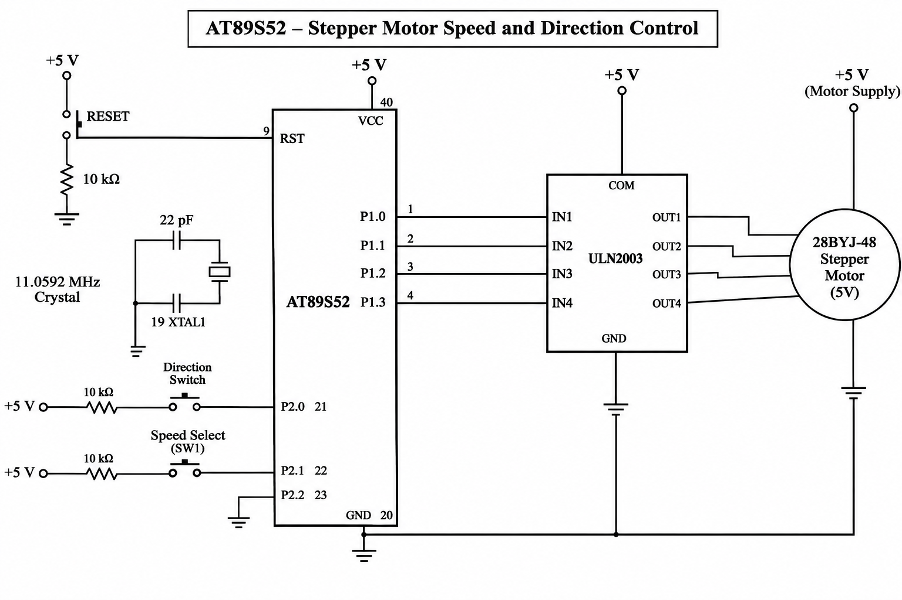

# CAT5 – Stepper Motor Speed and Direction Control

## EXP
CAT5

## DATE
10/08/2026 (Week 4)

## NAME OF EXP
Hardware Timer and Interrupt-Based Stepper Motor Control

## HARDWARE SETUP / PLATFORM

- **Development Board:** 8051 Universal Development Board
- **Microcontroller:** AT89S52
- **Programming Environment:** Keil µVision
- **Operating Voltage:** +5V
- **Clock Frequency:** 11.0592 MHz
- **Output Component:** 5V Stepper Motor (28BYJ-48)
- **Motor Driver:** ULN2003
- **Output Port:** Port 1
- **Motor Control Pins:** P1.0, P1.1, P1.2 and P1.3
- **Input Components:** Push-buttons
- **Direction Pin:** P2.0
- **Speed Selection Pins:** P2.1 and P2.2
- **Timer Used:** Timer 0
- **Timer Mode:** Mode 1 (16-bit timer)

## TASK NO

### Task 3: Stepper Motor Speed and Direction Control

Design and implement a timer-driven stepper motor control system using the AT89S52 microcontroller.

The hardware timer generates periodic interrupts that provide the timing reference for motor stepping.

The motor rotates using a four-step excitation sequence. Its speed is controlled by changing the time interval between consecutive steps, while its direction is controlled using a digital input.

## Circuit Diagram

## Core Logic / Pseudocode / Code Base

### 1. Core Logic

The program controls a stepper motor using Timer 0 interrupts and digital output signals.

- Four output pins of Port 1 are connected to a ULN2003 motor driver.
- The ULN2003 driver interfaces the AT89S52 with the stepper motor.
- Timer 0 generates periodic 1 ms interrupts.
- A software counter tracks the elapsed time.
- When the selected interval expires, the next motor step is generated.
- Direction and speed are selected using push-button inputs.

### 2. Stepper Motor Sequence

The motor is controlled using a four-step excitation sequence.

| Step | Output Pattern |
|---|---|
| Step 1 | 1000 |
| Step 2 | 0100 |
| Step 3 | 0010 |
| Step 4 | 0001 |

The sequence is repeated continuously to rotate the motor. Reversing the order of the sequence changes the direction of rotation.

### 3. Speed Control

The timer interval determines the motor speed.

| Speed | Time Interval |
|---|---|
| Slow | 100 ms/step |
| Medium | 50 ms/step |
| Fast | 10 ms/step |

A smaller interval produces faster motor rotation, while a larger interval produces slower rotation.

### 4. Direction Control

The direction of rotation is controlled through the P2.0 input.

- When the direction switch is not pressed, the motor follows the forward sequence.
- When the direction switch is pressed, the motor follows the reverse sequence.

### 5. Timer Configuration

Timer 0 is configured in Mode 1 (16-bit timer mode).

- `TMOD` configures Timer 0.
- `TH0 = 0xFC` and `TL0 = 0x66` generate an approximately 1 ms timer interval.
- `ET0 = 1` enables Timer 0 interrupts.
- `EA = 1` enables global interrupts.
- `TR0 = 1` starts Timer 0.

The interrupt service routine updates the timing counter and signals the main program when the next motor step is due.

### 6. Source Files

| File | Description |
|---|---|
| `stepper.c` | Main program implementing stepper motor control |
| `CAT5Task3.uvproj` | Keil project configuration file |
| `STARTUP.A51` | 8051 startup assembly file |
| `CAT5Task3.hex` | Generated HEX file |
| `circuit.png` | Stepper motor interfacing circuit diagram |

### 7. Programming Approach

- Bare-metal Embedded C programming.
- Direct register-level programming.
- Timer 0 configuration using TMOD.
- 16-bit timer operation.
- Interrupt-driven timing control.
- Four-step motor excitation sequence.
- Software-based speed selection.
- Digital input-based direction control.
- No Arduino APIs, HAL libraries or RTOS services.

## INFERENCE

The experiment demonstrates timer-based stepper motor control using the AT89S52 microcontroller.

Timer 0 generates periodic interrupts that provide the timing reference for motor operation. By changing the interval between consecutive motor steps, different motor speeds can be achieved.

The direction of rotation is controlled by changing the order of the excitation sequence. The experiment provides practical understanding of hardware timers, interrupts, digital output control, motor interfacing and embedded C programming.

## OBSERVATIONS

- The stepper motor rotates using a four-step excitation sequence.
- The ULN2003 driver is used to interface the motor with the microcontroller.
- Timer 0 interrupts provide the timing reference.
- The motor speed changes according to the selected time interval.
- The direction input controls forward and reverse rotation.
- The program uses timer-based timing instead of software delay loops.
