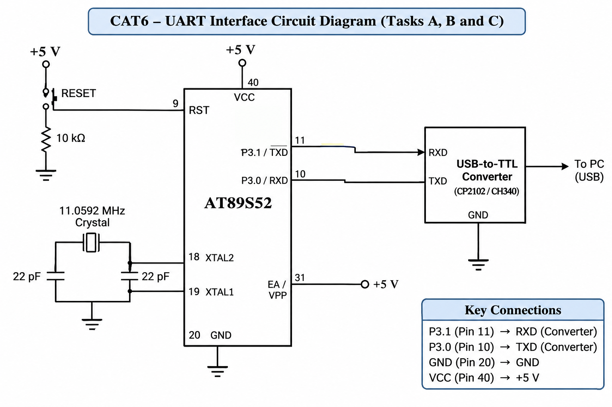

# CAT6 – Task A: UART Initialization and Character Transmission

## EXP
CAT6

## NAME OF EXP
UART Initialization and Character Transmission

## HARDWARE SETUP / PLATFORM

- **Microcontroller:** AT89S52
- **Development Board:** 8051 Universal Development Board
- **Programming Environment:** Keil µVision
- **Operating Voltage:** +5V
- **Crystal Frequency:** 11.0592 MHz
- **Communication Interface:** UART
- **UART Pins:** P3.0 (RXD), P3.1 (TXD)
- **Serial Converter:** USB-to-TTL Converter
- **PC Terminal:** PuTTY
- **Baud Rate:** 9600

## TASK DESCRIPTION

Configure the UART of the AT89S52 microcontroller for serial communication with a PC. Initialize the UART using Timer 1 in Mode 2 and continuously transmit the message "Hello from 8051" to the PC terminal.

## CIRCUIT DIAGRAM

## CORE LOGIC

1. Configure Timer 1 in Mode 2.
2. Load TH1 with 0xFD for 9600 baud.
3. Configure SCON for UART Mode 1.
4. Start Timer 1.
5. Load each character into SBUF.
6. Wait until TI becomes 1.
7. Clear TI and transmit the next character.
8. Continuously send the message to PuTTY.

## SOURCE FILES

| File | Description |
|---|---|
| `taskA.c` | UART initialization and transmission program |
| `STARTUP.A51` | 8051 startup assembly file |
| `CAT6_TaskA.uvproj` | Keil project file |
| `CAT6_TaskA.hex` | Generated HEX file |
| `circuit.png` | UART interface circuit diagram |

## PROGRAMMING APPROACH

- Bare-metal Embedded C programming.
- Direct register-level programming.
- UART configuration using SCON and SBUF.
- Timer 1 Mode 2 for baud-rate generation.
- Polling-based transmission using the TI flag.
- Serial debugging using PuTTY.

## INFERENCE

The experiment demonstrates UART initialization and serial character transmission using the AT89S52. Timer 1 generates the required baud rate, while the SBUF register is used to transmit characters to the PC. The successful display of the message in PuTTY verifies serial communication.

## OBSERVATIONS

- UART communication is configured at 9600 baud.
- Timer 1 operates in Mode 2.
- The message is continuously displayed in PuTTY.
- The TI flag indicates completion of character transmission.