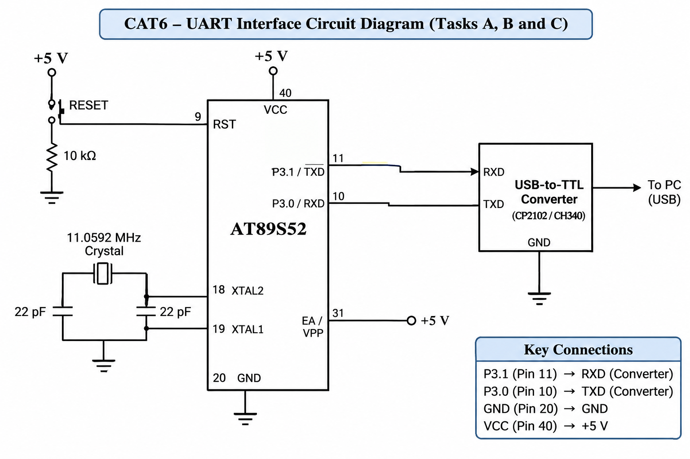

# CAT6 – Task B: UART Character Reception and Echo

## EXP
CAT6

## NAME OF EXP
UART Character Reception and Echo

## HARDWARE SETUP / PLATFORM

- **Microcontroller:** AT89S52
- **Development Board:** 8051 Universal Development Board
- **Programming Environment:** Keil µVision
- **Operating Voltage:** +5V
- **Crystal Frequency:** 11.0592 MHz
- **Communication Interface:** UART
- **UART Pins:** P3.0 (RXD), P3.1 (TXD)
- **Serial Converter:** USB-to-TTL Converter
- **PC Terminal:** PuTTY
- **Baud Rate:** 9600

## TASK DESCRIPTION

Modify the UART transmission program to receive characters from the PC terminal and transmit the same characters back to the PC. The program implements a basic UART echo mechanism using polling.

## CIRCUIT DIAGRAM

## CORE LOGIC

1. Initialize UART using Timer 1 in Mode 2.
2. Configure the serial communication for 9600 baud.
3. Wait until the RI flag becomes 1.
4. Read the received character from SBUF.
5. Clear the RI flag.
6. Load the received character into SBUF for transmission.
7. Wait until TI becomes 1.
8. Clear TI and repeat the process.

## SOURCE FILES

| File | Description |
|---|---|
| `taskB.c` | UART reception and echo program |
| `STARTUP.A51` | 8051 startup assembly file |
| `CAT6_TaskB.uvproj` | Keil project file |
| `CAT6_TaskB.hex` | Generated HEX file |
| `circuit.png` | UART interface circuit diagram |

## PROGRAMMING APPROACH

- Bare-metal Embedded C programming.
- Direct register-level programming.
- UART configuration using SCON and SBUF.
- Timer 1 Mode 2 for baud-rate generation.
- Polling-based character reception using RI.
- Polling-based character transmission using TI.
- Serial debugging using PuTTY.

## INFERENCE

The experiment demonstrates bidirectional serial communication between the AT89S52 and a PC. Characters entered in PuTTY are received by the microcontroller and transmitted back using UART. The experiment provides an understanding of UART reception, transmission flags and serial communication.

## OBSERVATIONS

- Characters entered in PuTTY are successfully received.
- The received characters are transmitted back to the PC.
- The RI flag indicates character reception.
- The TI flag indicates completion of transmission.
- UART communication operates at 9600 baud.