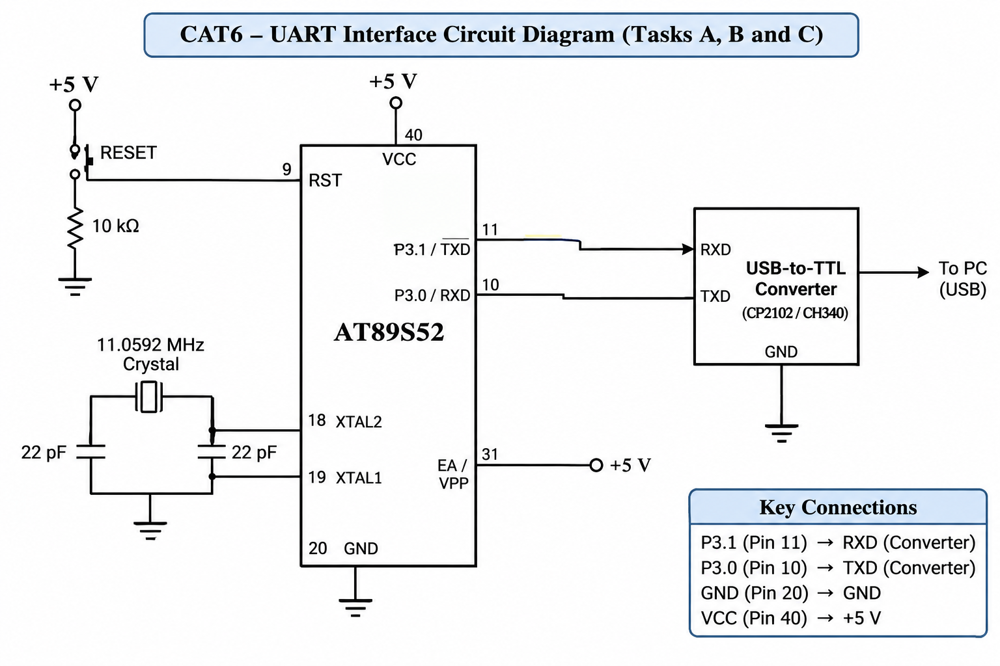

# CAT6 – Task C: Interrupt-Driven UART Reception Using Ring Buffer

## EXP
CAT6

## NAME OF EXP
Interrupt-Driven UART Reception and Circular Buffer Implementation

## HARDWARE SETUP / PLATFORM

- **Microcontroller:** AT89S52
- **Development Board:** 8051 Universal Development Board
- **Programming Environment:** Keil µVision
- **Operating Voltage:** +5V
- **Crystal Frequency:** 11.0592 MHz
- **Communication Interface:** UART
- **UART Pins:** P3.0 (RXD), P3.1 (TXD)
- **Serial Converter:** USB-to-TTL Converter
- **PC Terminal:** PuTTY
- **Baud Rate:** 9600
- **Buffer Size:** 16 bytes

## TASK DESCRIPTION

Implement interrupt-driven UART reception using the serial interrupt of the AT89S52. Received characters are stored in a circular buffer and subsequently processed by the main program. The characters are transmitted back to the PC terminal.

## CIRCUIT DIAGRAM

## CORE LOGIC

1. Initialize UART using Timer 1 in Mode 2.
2. Enable serial and global interrupts.
3. Wait for incoming serial data.
4. When a character is received, the serial interrupt is triggered.
5. Read the received character from SBUF.
6. Store the character in the circular buffer.
7. Update the head pointer.
8. The main program checks whether the buffer contains data.
9. Read the character using the tail pointer.
10. Transmit the character back to the PC.

## RING BUFFER IMPLEMENTATION

The circular buffer uses two index variables.

- **Head:** Indicates the next available position for storing incoming data.
- **Tail:** Indicates the next position from which data should be read.
- **Buffer Size:** 16 bytes.
- **Usable Capacity:** 15 bytes, with one position reserved to distinguish full and empty states.

When the buffer becomes full, additional incoming characters are discarded.

## SOURCE FILES

| File | Description |
|---|---|
| `taskC.c` | Interrupt-driven UART reception and ring buffer program |
| `STARTUP.A51` | 8051 startup assembly file |
| `CAT6_TaskC.uvproj` | Keil project file |
| `CAT6_TaskC.hex` | Generated HEX file |
| `circuit.png` | UART interface circuit diagram |

## PROGRAMMING APPROACH

- Bare-metal Embedded C programming.
- Direct register-level programming.
- UART configuration using SCON and SBUF.
- Timer 1 Mode 2 for baud-rate generation.
- Serial interrupt handling using interrupt 4.
- Circular buffer implementation.
- Head and tail pointer management.
- Interrupt-driven character reception.
- Serial debugging using PuTTY.

## INFERENCE

The experiment demonstrates interrupt-driven UART communication and circular buffer management using the AT89S52. The serial interrupt allows incoming characters to be handled without continuously polling the receive flag. The ring buffer temporarily stores received characters until the main program processes them.

The experiment provides practical understanding of serial interrupts, asynchronous communication, circular buffers and efficient data handling in embedded systems.

## OBSERVATIONS

- The serial interrupt is triggered when a character is received.
- Incoming characters are stored in the circular buffer.
- The head and tail variables manage buffer positions.
- The main program retrieves and echoes buffered characters.
- Buffer overflow is handled by discarding new characters when full.
- UART communication operates at 9600 baud.