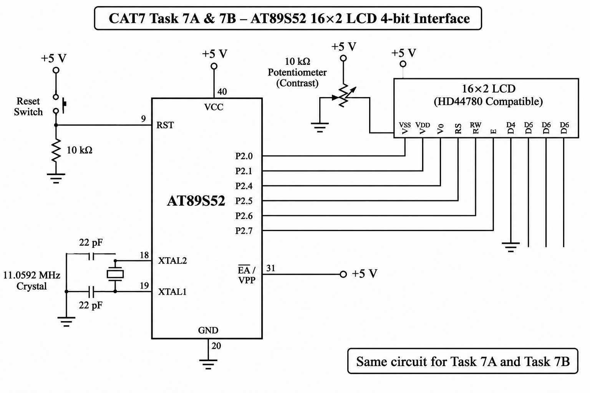

# CAT7 – Task 7A: LCD Initialization and Character/String Display

## EXP
CAT7

## DATE
24/08/2026 (Week 6)

## NAME OF EXP
LCD Initialization and Character/String Display

## HARDWARE SETUP / PLATFORM

- **Development Board:** 8051 Universal Development Board
- **Microcontroller:** AT89S52
- **Programming Environment:** Keil µVision
- **Operating Voltage:** +5V
- **Display:** 16×2 Character LCD
- **LCD Controller:** HD44780 Compatible
- **LCD Interface:** 4-bit GPIO Mode
- **LCD Data Pins:** D4, D5, D6 and D7
- **LCD Control Pins:** RS and E
- **Programming Language:** Embedded C

## TASK NO

### Task 7A – LCD Initialization and Character/String Display

Develop a 4-bit GPIO-based LCD driver for the AT89S52 by deriving the required command sequence from the HD44780-compatible LCD datasheet.

The objective is to initialize a 16×2 LCD, configure its operating mode and display individual characters and strings on both rows.

## CIRCUIT DIAGRAM

### LCD Pin Connections

| LCD Pin | AT89S52 Connection |
|---|---|
| RS | P2.0 |
| RW | GND |
| E | P2.1 |
| D4 | P2.4 |
| D5 | P2.5 |
| D6 | P2.6 |
| D7 | P2.7 |
| VSS | GND |
| VDD | +5V |
| V0 | Contrast potentiometer |

## CORE LOGIC / PSEUDOCODE / CODE BASE

### 1. Core Logic

The program implements a low-level LCD driver using direct GPIO register manipulation.

- The LCD operates in 4-bit mode.
- The LCD is configured for two-line operation.
- Commands are sent using the RS and E control pins.
- Character data is transferred through D4–D7.
- Individual characters and strings are displayed on the LCD.

### 2. LCD Initialization

The `lcd_init()` function configures the LCD for 4-bit, 2-line operation.

The initialization sequence includes:

- Setting the LCD interface to 4-bit mode.
- Selecting two-line display operation.
- Configuring the display and cursor settings.
- Enabling the display.
- Clearing the display.
- Setting the entry mode.

### 3. LCD Driver Functions

| Function | Description |
|---|---|
| `lcd_init()` | Initializes the LCD |
| `lcd_cmd()` | Sends commands to the LCD |
| `lcd_data()` | Sends character data to the LCD |

The `lcd_cmd()` function sends control instructions, whereas `lcd_data()` transfers characters for display.

### 4. Display Operation

The program performs the following operations:

1. Initialize the LCD.
2. Select the first position of the first row.
3. Send the character `A` using `lcd_data()`.
4. Display individual characters.
5. Display strings using repeated character transmission.
6. Display text on both LCD rows.

### 5. Source Files

| File | Description |
|---|---|
| `task7A.c` | LCD initialization and character/string display program |
| `STARTUP.A51` | 8051 startup assembly file |
| `CAT7_TaskA.uvproj` | Keil project configuration file |
| `CAT7_TaskA.hex` | Generated HEX file |
| `circuit.png` | Common LCD and keypad circuit diagram |

## PROGRAMMING APPROACH

- Bare-metal Embedded C programming.
- Direct GPIO register-level programming.
- 4-bit LCD interfacing.
- HD44780-compatible command sequence.
- LCD initialization and configuration.
- Character and string display.
- No Arduino APIs, HAL libraries or RTOS services.

## INFERENCE

The experiment demonstrates low-level interfacing of a 16×2 LCD with the AT89S52 microcontroller using a 4-bit GPIO interface.

The LCD is initialized by sending a sequence of commands to configure its operating mode. Character and string display functions are implemented to transfer data to the LCD.

The experiment provides practical understanding of peripheral datasheets, LCD command sequences, GPIO control and Embedded C driver development.

## OBSERVATIONS

- The LCD is initialized in 4-bit mode.
- The display operates in two-line mode.
- Individual characters are displayed successfully.
- Strings are displayed on both LCD rows.
- LCD commands and character data are transferred using separate functions.