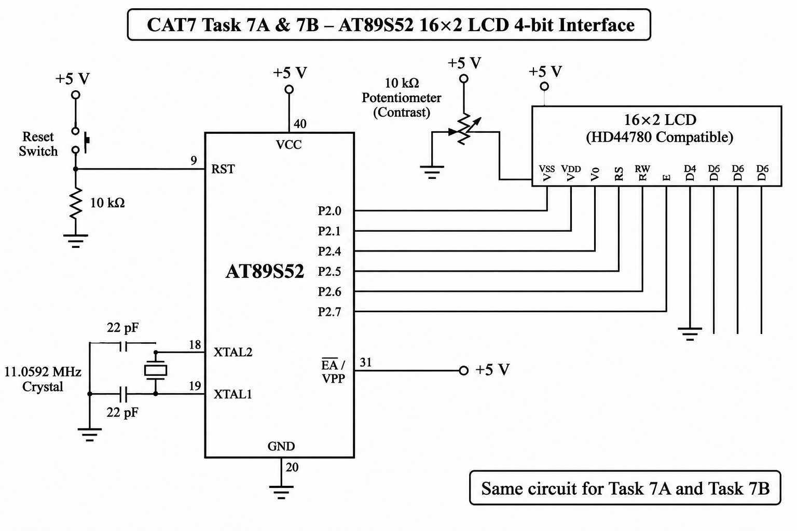

# CAT7 – Task 7B: Cursor Positioning and Dynamic Value Update

## EXP
CAT7

## DATE
24/08/2026 (Week 6)

## NAME OF EXP
LCD Cursor Positioning and Dynamic Value Update

## HARDWARE SETUP / PLATFORM

- **Development Board:** 8051 Universal Development Board
- **Microcontroller:** AT89S52
- **Programming Environment:** Keil µVision
- **Operating Voltage:** +5V
- **Display:** 16×2 Character LCD
- **LCD Controller:** HD44780 Compatible
- **LCD Interface:** 4-bit GPIO Mode
- **LCD Data Pins:** D4, D5, D6 and D7
- **LCD Control Pins:** RS and E
- **Programming Language:** Embedded C

## TASK NO

### Task 7B – Cursor Positioning and Dynamic Value Update

Develop LCD cursor-positioning and data-update functions for the AT89S52 microcontroller.

The objective is to position the LCD cursor at specific row and column locations, display strings, print numerical values and update displayed information dynamically.

## CIRCUIT DIAGRAM

### LCD Pin Connections

| LCD Pin | AT89S52 Connection |
|---|---|
| RS | P2.0 |
| RW | GND |
| E | P2.1 |
| D4 | P2.4 |
| D5 | P2.5 |
| D6 | P2.6 |
| D7 | P2.7 |
| VSS | GND |
| VDD | +5V |
| V0 | Contrast potentiometer |

## CORE LOGIC / PSEUDOCODE / CODE BASE

### 1. Core Logic

The program extends the LCD driver developed in Task 7A by implementing additional functions for cursor positioning and dynamic data display.

- Initialize the LCD in 4-bit mode.
- Position the cursor at a specified row and column.
- Display strings at selected positions.
- Convert numerical values into displayable characters.
- Update values at specific LCD locations.

### 2. LCD Cursor Positioning

The `lcd_goto(row, column)` function positions the cursor at the required LCD location.

- The LCD contains two rows.
- Each row supports 16 character positions.
- The cursor position is selected by sending the corresponding DDRAM address command.

### 3. LCD Display Functions

The following functions are implemented:

| Function | Description |
|---|---|
| `lcd_init()` | Initializes the LCD |
| `lcd_cmd()` | Sends LCD commands |
| `lcd_data()` | Sends character data |
| `lcd_goto(row, column)` | Positions the cursor |
| `lcd_puts(string)` | Displays a string |
| `lcd_print_number(value)` | Displays a numerical value |

### 4. Dynamic Value Update

The program uses cursor positioning to update information at specific LCD locations.

The implementation follows these steps:

1. Initialize the LCD.
2. Position the cursor using `lcd_goto()`.
3. Display text using `lcd_puts()`.
4. Position the cursor at the required numerical display location.
5. Display a number using `lcd_print_number()`.
6. Update the displayed value when required.
7. Clear or overwrite previous characters to avoid leftover digits.

### 5. Source Files

| File | Description |
|---|---|
| `task7B.c` | LCD cursor positioning and dynamic value update program |
| `STARTUP.A51` | 8051 startup assembly file |
| `CAT7_TaskB.uvproj` | Keil project configuration file |
| `CAT7_TaskB.hex` | Generated HEX file |
| `circuit.png` | Common LCD and keypad circuit diagram |

## PROGRAMMING APPROACH

- Bare-metal Embedded C programming.
- Direct GPIO register-level programming.
- 4-bit LCD interfacing.
- LCD command and data transfer.
- Cursor positioning using DDRAM addresses.
- String display.
- Numerical value conversion and display.
- Dynamic LCD updates.
- No Arduino APIs, HAL libraries or RTOS services.

## INFERENCE

The experiment demonstrates cursor positioning and dynamic display control using a 16×2 LCD connected to the AT89S52 microcontroller.

The `lcd_goto()` function allows information to be displayed at specific row and column positions. Additional functions support string and numerical value display, enabling the LCD to update information without repeatedly initializing the display.

The experiment provides practical understanding of LCD addressing, cursor control, numerical data display and Embedded C driver development.

## OBSERVATIONS

- The LCD cursor is positioned at the required row and column.
- Strings are displayed at selected positions.
- Numerical values are displayed using a dedicated function.
- Displayed values can be updated dynamically.
- The LCD driver supports both character and numerical data display.