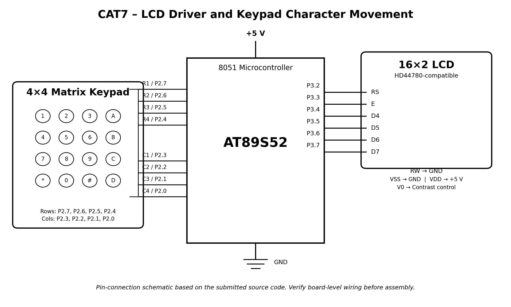

# CAT7 – 16×2 LCD Driver Development and Dynamic Display Control

## EXP
CAT7

## DATE
24/08/2026 (Week 6)

## NAME OF EXP
16×2 LCD Driver Development and Dynamic Display Control

## HARDWARE SETUP / PLATFORM

- **Development Board:** 8051 Development Board
- **Microcontroller:** AT89S52
- **LCD:** 16×2 HD44780-compatible character LCD
- **Input Device:** 4×4 matrix keypad
- **Programming Language:** Embedded C
- **IDE / Toolchain:** Keil µVision

### Pin Configuration

| Peripheral | Signal | AT89S52 pin |
|---|---|---|
| LCD | RS | P3.2 |
| LCD | E | P3.3 |
| LCD | D4 | P3.4 |
| LCD | D5 | P3.5 |
| LCD | D6 | P3.6 |
| LCD | D7 | P3.7 |
| Keypad | Row 1 | P2.7 |
| Keypad | Row 2 | P2.6 |
| Keypad | Row 3 | P2.5 |
| Keypad | Row 4 | P2.4 |
| Keypad | Column 1 | P2.3 |
| Keypad | Column 2 | P2.2 |
| Keypad | Column 3 | P2.1 |
| Keypad | Column 4 | P2.0 |

**LCD connections:** The code writes the upper nibble of Port 3 to the LCD data lines. Connect LCD D4–D7 to P3.4–P3.7 respectively. The code does not control RW, so connect RW to GND for write-only operation. LCD VSS and VDD connect to GND and +5 V; V0 is used for contrast adjustment.

## TASK NO

The evaluation is titled **16×2 LCD Driver Development and Dynamic Display Control** and specifies three tasks:

### Task 7A – LCD Initialization and Character/String Display

Develop a 4-bit GPIO-based LCD driver by deriving the required command sequence from the HD44780-compatible LCD datasheet.

- Configure the LCD in 4-bit, 2-line mode.
- Implement `lcd_init()`, `lcd_cmd()` and `lcd_data()`.
- Display individual characters and strings.
- Display text on both rows.

### Task 7B – Cursor Positioning and Dynamic Value Update

Develop LCD cursor-positioning and data-update functions. The evaluation specifies:

- `lcd_goto(row, column)`
- `lcd_puts(string)`
- `lcd_print_number(value)`

### Task 7C – 4×4 Keypad-Based Character Movement

Develop an interactive LCD application in which a character is moved across the 16×2 display using the 4×4 keypad.

| Key | Action |
|---|---|
| 2 | Move Up |
| 8 | Move Down |
| 4 | Move Left |
| 6 | Move Right |

## Circuit Diagram

*This is a pin-connection schematic derived from the submitted source files. The exact physical board layout, LCD contrast wiring, supply implementation and any on-board circuitry were not included in the ZIP. Verify these against the board schematic before reproducing the hardware.*

## Core Logic / Pseudocode / Code Base

### 1. LCD Driver

`LCD.c` contains the LCD interface routines:

- `lcd_init()` initializes the LCD.
- `lcd_cmd()` sends command bytes.
- `lcd_data()` sends character data.
- `lcd_send_nibble()` transfers the upper four bits to the LCD.
- `lcd_enable()` generates the Enable pulse.
- `lcd_string()` displays a null-terminated string.
- `lcd_goto()` positions the cursor at the requested row and column.

The LCD is configured for 4-bit, 2-line operation using command `0x28`. The display-control command is `0x0F`, the entry-mode command is `0x06`, and `0x01` clears the display.

### 2. Keypad Scanning

`keypad.c` scans the 4×4 matrix keypad by driving one row low at a time and checking the column inputs.

The function `keypad_scan()` returns a key code for the detected key. The numeric keypad positions return codes 1–9 and 0; A–D, `*` and `#` return codes 10–15. It returns 255 when no key is detected.

### 3. Character Movement

The main loop in `LCD.c` maintains the character position using `row` and `column` variables.

- The `*` character is initially displayed at row 0, column 0.
- Before movement, the previous character position is cleared with a space.
- Key 2 decrements the row when the character is not already on the first row.
- Key 8 increments the row while the character is on the first row.
- Key 4 decrements the column when the character is not at the left edge.
- Key 6 increments the column while the character is before the last column.
- The `*` character is then displayed at the updated position.

A delay is added between movement updates.

### 4. Source Files

| File | Description |
|---|---|
| `LCD.c` | LCD initialization, command/data transfer, cursor positioning, string output and character movement |
| `keypad.c` | 4×4 matrix keypad scanning |
| `delay.c` | Software delay routine |
| `DAY6TASK1.uvproj` | Keil µVision project configuration |
| `STARTUP.A51` | 8051 startup assembly file |

## IMPLEMENTATION NOTES

- The supplied project combines LCD driver routines and keypad-based character movement in `LCD.c`.
- The LCD code implements `lcd_string()` rather than the exact function name `lcd_puts()` specified in Task 7B.
- The supplied code does not contain an `lcd_print_number()` function, so the complete Task 7B function set is not present in this archive.
- `LCD.c` calls `keypad_scan()` but does not include a keypad header or function prototype in the supplied source.
- `keypad.c` includes `keypad.h`, and `delay.c` includes `delay.h`; these header files were not present in the uploaded ZIP.
- The source implements the directional controls required for Task 7C.
- The supplied project uses GPIO-based LCD and keypad interfacing with software delays. No Arduino APIs, HAL libraries or RTOS services are used.

## INFERENCE

The experiment demonstrates the development of a low-level 4-bit LCD interface and its integration with a 4×4 matrix keypad using the AT89S52 microcontroller.

The LCD driver provides initialization, command transfer, character output, string display and cursor positioning. The keypad scanning routine detects key presses, and the main application uses the directional keys 2, 8, 4 and 6 to move a `*` character within the 16×2 LCD boundaries.

The submitted source demonstrates the core LCD interfacing and keypad-controlled movement functionality. The missing header files and the absent `lcd_print_number()` routine should be addressed if the project is expected to build independently and satisfy every specified Task 7B function.
