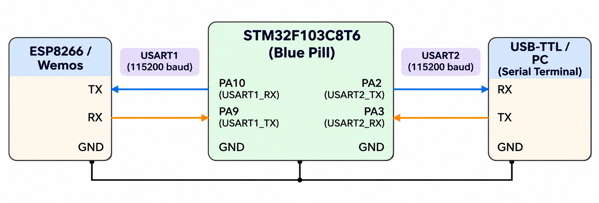

# CAT 10 – ESP8266 AT Command Interface

**EXP CAT:** CAT 10  
**TASK:** TASK 10B  
**NAME:** ESP8266 AT Command Interface

## Objective
To explore the ESP8266 AT command interface by sending commands through the STM32 microcontroller and observing the responses.

## Hardware and Software Requirements
- STM32F103C8T6 Blue Pill
- ESP8266 / Wemos module
- USB-TTL converter
- STM32CubeMX
- Keil uVision
- Serial terminal software

## Pin Connections

**USART1 – STM32 to ESP8266**

| STM32 Pin | ESP8266 / Wemos |
|---|---|
| PA9 (USART1_TX) | RX |
| PA10 (USART1_RX) | TX |
| GND | GND |

**USART2 – STM32 to PC**

| STM32 Pin | USB-TTL Converter |
|---|---|
| PA2 (USART2_TX) | RX |
| PA3 (USART2_RX) | TX |
| GND | GND |

## Circuit Diagram

## UART Configuration

| Parameter | USART1 | USART2 |
|---|---|---|
| Baud Rate | 115200 | 115200 |
| Word Length | 8 Bits | 8 Bits |
| Stop Bits | 1 | 1 |
| Parity | None | None |
| Mode | Transmitter and Receiver | Transmitter and Receiver |

## Working Principle
- USART1 is used for communication between the STM32 and ESP8266.
- USART2 is used for communication between the STM32 and the PC.
- The STM32 receives commands from the PC through USART2.
- The received characters are forwarded to the ESP8266 through USART1.
- Responses from the ESP8266 are received through USART1 and forwarded to the PC through USART2.
- This allows the user to investigate ESP8266 AT commands using a serial terminal.

## AT Commands to Investigate

| Requirement | AT Command |
|---|---|
| Check modem response | `AT` |
| Check firmware/version | `AT+GMR` |
| Set Wi-Fi station mode | `AT+CWMODE=1` |
| Scan available networks | `AT+CWLAP` |
| Connect to an access point | `AT+CWJAP` |
| Obtain network information | `AT+CIFSR` |
| Establish TCP connection | `AT+CIPSTART` |
| Send application data | `AT+CIPSEND` |

## Algorithm
1. Initialize the HAL library.
2. Configure the system clock.
3. Initialize GPIO.
4. Initialize USART1 and USART2.
5. Display the AT command interface on the PC serial terminal.
6. Receive characters from the PC through USART2.
7. Forward the received characters to the ESP8266 through USART1.
8. Receive responses from the ESP8266 through USART1.
9. Forward the responses to the PC through USART2.
10. Repeat continuously.

## HAL Functions Used
- `HAL_Init()`
- `HAL_UART_Init()`
- `HAL_UART_Receive()`
- `HAL_UART_Transmit()`
- `HAL_RCC_OscConfig()`
- `HAL_RCC_ClockConfig()`

## Source Code
`Core/Src/main.c`

## Result
The STM32 acts as a UART bridge between the PC and ESP8266, allowing AT commands to be sent and the corresponding responses to be observed.

## Inference
This experiment demonstrates serial communication using two UART peripherals and exploration of the ESP8266 AT command interface.
