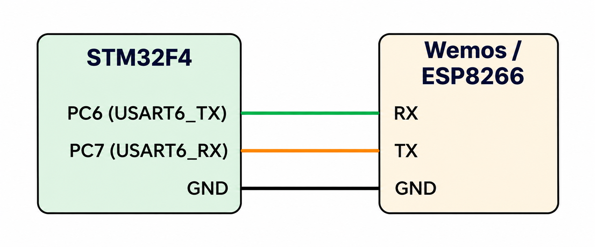

# CAT 11 – ESP8266 Wi-Fi and TCP Server Configuration

**EXP CAT:** CAT 11  
**TASK:** TASK 11A  
**NAME:** ESP8266 Wi-Fi Connection and TCP Server Setup

## Objective
To configure the ESP8266/Wemos module using AT commands, connect it to a Wi-Fi access point, and start a TCP server.

## Hardware and Software Requirements
- STM32F4 microcontroller board
- ESP8266 / Wemos module
- STM32CubeMX
- Keil uVision

## Pin Connections

| STM32F4 Pin | Wemos / ESP8266 |
|---|---|
| PC6 (USART6_TX) | RX |
| PC7 (USART6_RX) | TX |
| GND | GND |

## Circuit Diagram

## UART Configuration

| Parameter | Configuration |
|---|---|
| UART Peripheral | USART6 |
| Baud Rate | 115200 |
| Word Length | 8 Bits |
| Stop Bits | 1 |
| Parity | None |
| Mode | Transmitter and Receiver |

## Working Principle
- The STM32 initializes the USART6 peripheral for serial communication with the Wemos module.
- It waits for the Wemos module to initialize.
- It sends AT commands and receives responses.
- The ESP8266 is configured in Wi-Fi station mode.
- It connects to the specified Wi-Fi access point.
- Multiple connections are enabled.
- A TCP server is started on port 80.
- The IP address of the Wemos module is requested.

## AT Commands Used

| Purpose | AT Command |
|---|---|
| Test communication | `AT` |
| Set Wi-Fi station mode | `AT+CWMODE=1` |
| Connect to Wi-Fi | `AT+CWJAP` |
| Enable multiple connections | `AT+CIPMUX=1` |
| Start TCP server on port 80 | `AT+CIPSERVER=1,80` |
| Get IP address | `AT+CIFSR` |

## Algorithm
1. Initialize the HAL library.
2. Configure the system clock.
3. Initialize GPIO and USART6.
4. Wait for the Wemos module to initialize.
5. Send the `AT` command to test communication.
6. Set the Wi-Fi station mode.
7. Connect to the Wi-Fi access point.
8. Enable multiple connections.
9. Start the TCP server on port 80.
10. Request the Wemos IP address.

## HAL Functions Used
- `HAL_Init()`
- `HAL_Delay()`
- `HAL_UART_Init()`
- `HAL_UART_Transmit()`
- `HAL_UART_Receive()`
- `HAL_GetTick()`
- `HAL_RCC_OscConfig()`
- `HAL_RCC_ClockConfig()`

## Source Code
`Core/Src/main.c`

## Result
The STM32 sends AT commands to configure the ESP8266 for Wi-Fi connectivity and TCP server operation.

## Inference
This experiment demonstrates UART-based communication with the ESP8266 and its configuration as a Wi-Fi-connected TCP server.
