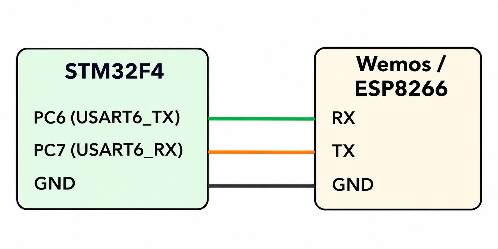

# CAT 11 – STM32-Based HTTP Web Server Using ESP8266

**EXP CAT:** CAT 11  
**TASK:** TASK 11B  
**NAME:** HTTP Web Server Using ESP8266

## Objective
To create a simple web server using the STM32 microcontroller and ESP8266 Wi-Fi module. The server responds to HTTP requests with an HTML webpage containing a randomly generated letter.

## Hardware and Software Requirements
- STM32F4 microcontroller board
- ESP8266 / Wemos module
- STM32CubeMX
- Keil uVision
- Wi-Fi access point
- Web browser

## Pin Connections

| STM32F4 Pin | Wemos / ESP8266 |
|---|---|
| PC6 (USART6_TX) | RX |
| PC7 (USART6_RX) | TX |
| GND | GND |

## Circuit Diagram

## UART Configuration

| Parameter | Configuration |
|---|---|
| UART Peripheral | USART6 |
| Baud Rate | 115200 |
| Word Length | 8 Bits |
| Stop Bits | 1 |
| Parity | None |
| Mode | Transmitter and Receiver |

## Working Principle
- The STM32 initializes USART6 to communicate with the ESP8266.
- It tests communication with the `AT` command.
- It configures the ESP8266 in Wi-Fi station mode.
- It connects to the specified Wi-Fi network.
- It obtains the network information and starts a TCP server on port 80.
- When a browser sends an HTTP request, the ESP8266 forwards the request to the STM32.
- The STM32 extracts the connection ID from the received data.
- It generates a random letter and creates an HTML response.
- The response is transmitted to the ESP8266 and sent to the browser.
- The TCP connection is then closed.

## AT Commands Used

| Purpose | AT Command |
|---|---|
| Test communication | `AT` |
| Set Wi-Fi station mode | `AT+CWMODE=1` |
| Connect to Wi-Fi | `AT+CWJAP` |
| Get IP address | `AT+CIFSR` |
| Enable multiple connections | `AT+CIPMUX=1` |
| Start TCP server | `AT+CIPSERVER=1,80` |
| Send data | `AT+CIPSEND` |
| Close connection | `AT+CIPCLOSE` |

## Algorithm
1. Initialize the HAL library.
2. Configure the system clock.
3. Initialize GPIO and USART6.
4. Wait for the ESP8266 to initialize.
5. Send AT commands to connect to Wi-Fi.
6. Enable multiple connections.
7. Start the TCP server on port 80.
8. Wait for an incoming HTTP request.
9. Extract the connection ID from the received request.
10. Generate a random letter.
11. Prepare an HTML webpage containing the generated letter.
12. Send the HTTP response to the browser.
13. Close the TCP connection.
14. Repeat continuously.

## HAL Functions Used
- `HAL_Init()`
- `HAL_Delay()`
- `HAL_UART_Init()`
- `HAL_UART_Transmit()`
- `HAL_UART_Receive()`
- `HAL_GetTick()`
- `HAL_RCC_OscConfig()`
- `HAL_RCC_ClockConfig()`

## Source Code
`Core/Src/main.c`

## Result
A simple HTTP web server is configured using the STM32 and ESP8266. When a client accesses the server through a browser, a webpage displaying a greeting and a randomly generated letter is returned.

## Inference
This experiment demonstrates Wi-Fi communication, TCP server configuration, HTTP request handling, and dynamic webpage generation using an STM32 microcontroller.
