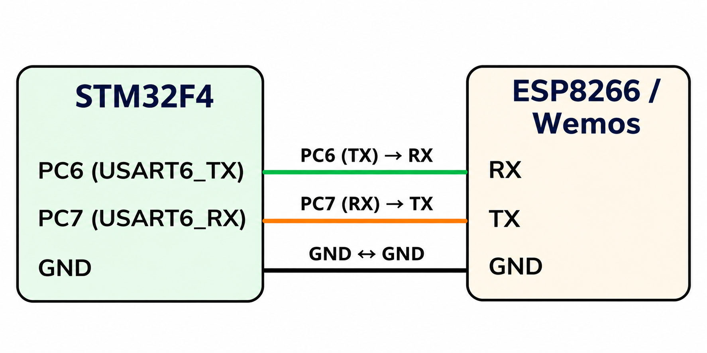

# CAT 11 – HTTP Web Server with Dynamic Webpage

**EXP CAT:** CAT 11  
**TASK:** TASK 11C  
**NAME:** HTTP Web Server with Random Letter Generation

## Objective
To create an HTTP web server using an STM32F4 microcontroller and ESP8266 Wi-Fi module. The server receives browser requests and responds with an HTML webpage displaying a greeting and a randomly generated letter.

## Hardware and Software Requirements
- STM32F4 microcontroller board
- ESP8266 / Wemos module
- STM32CubeMX
- Keil uVision
- Wi-Fi access point
- Web browser

## Pin Connections

| STM32F4 Pin | ESP8266 / Wemos |
|---|---|
| PC6 (USART6_TX) | RX |
| PC7 (USART6_RX) | TX |
| GND | GND |

## Circuit Diagram

## UART Configuration

| Parameter | Configuration |
|---|---|
| UART Peripheral | USART6 |
| Baud Rate | 115200 |
| Word Length | 8 Bits |
| Stop Bits | 1 |
| Parity | None |
| Mode | Transmitter and Receiver |

## Working Principle
- The STM32 initializes USART6 for communication with the ESP8266.
- It tests communication using the `AT` command.
- It configures the ESP8266 in Wi-Fi station mode.
- It connects to the specified Wi-Fi network.
- It obtains the IP address and starts a TCP server on port 80.
- The STM32 continuously waits for incoming HTTP requests.
- It extracts the connection ID from the received `+IPD` message.
- It generates a random letter from A to Z.
- It creates an HTML webpage containing a greeting and the generated letter.
- It sends the HTTP response to the browser through the ESP8266.
- It closes the TCP connection after sending the response.

## AT Commands Used

| Purpose | AT Command |
|---|---|
| Test communication | `AT` |
| Set Wi-Fi station mode | `AT+CWMODE=1` |
| Connect to Wi-Fi | `AT+CWJAP` |
| Get IP address | `AT+CIFSR` |
| Start TCP server | `AT+CIPSERVER=1,80` |
| Send data | `AT+CIPSEND` |
| Close connection | `AT+CIPCLOSE` |

## Algorithm
1. Initialize the HAL library.
2. Configure the system clock.
3. Initialize GPIO and USART6.
4. Wait for the ESP8266 to initialize.
5. Test communication with the ESP8266.
6. Configure Wi-Fi station mode.
7. Connect to the Wi-Fi access point.
8. Obtain the ESP8266 IP address.
9. Start the TCP server on port 80.
10. Wait for an incoming HTTP request.
11. Extract the TCP connection ID.
12. Generate a random letter.
13. Create an HTML response containing the generated letter.
14. Send the response to the browser.
15. Close the TCP connection and continue waiting for requests.

## HAL Functions Used
- `HAL_Init()`
- `HAL_Delay()`
- `HAL_UART_Init()`
- `HAL_UART_Transmit()`
- `HAL_UART_Receive()`
- `HAL_GetTick()`
- `HAL_RCC_OscConfig()`
- `HAL_RCC_ClockConfig()`

## Source Code
`Core/Src/main.c`

## Result
An HTTP web server is implemented using the STM32F4 and ESP8266. When a browser accesses the server, it receives an HTML webpage displaying a greeting and a randomly generated letter.

## Inference
This experiment demonstrates UART communication, ESP8266 Wi-Fi configuration, TCP server operation, HTTP request handling, and dynamic webpage generation using an STM32 microcontroller.
