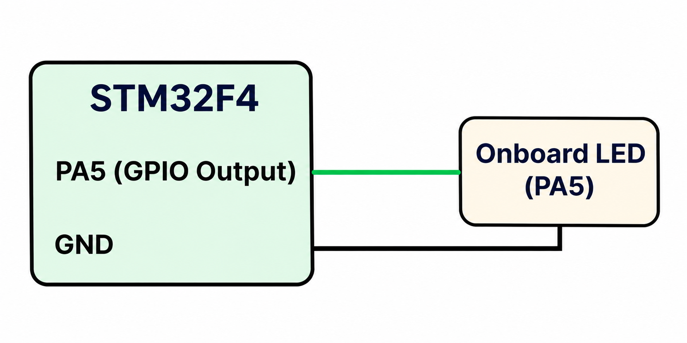

# CAT 12 – STM32 LED Pattern Generation

## EXP CAT12 TASK12A

### Name
LED Pattern Generation Using GPIO Output

### Board
STM32F4

### Software Used
- STM32CubeMX
- Keil uVision

### Circuit Diagram

### Description
This experiment demonstrates LED control using GPIO output on the STM32F4 board. The LED connected to PA5 is controlled through GPIO write operations to generate a repeating blinking pattern.

### Pin Configuration

| Component | STM32 Pin |
|---|---|
| LED | PA5 |

### Working
The program generates the following repeating LED pattern:

1. LED turns ON for 200 ms.
2. LED turns OFF for 200 ms.
3. LED turns ON for 200 ms.
4. LED turns OFF for 200 ms.
5. LED turns ON for 2000 ms.
6. LED turns OFF for 100 ms.
7. The sequence repeats continuously.

### HAL Functions Used
- `HAL_GPIO_WritePin()` – Sets the LED output HIGH or LOW.
- `HAL_Delay()` – Provides the required time delay.

### Source Code
`Core/Src/main.c`

### Inference
The experiment demonstrates GPIO output control and generation of a predefined LED blinking pattern using HAL functions and software delays.