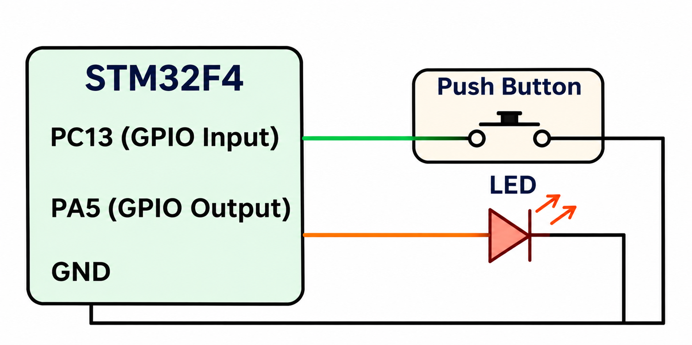

# CAT 12 – GPIO Button-Controlled LED

**EXP:** CAT 12 – TASK 12B

## Experiment Name
Button-Controlled LED Toggle

## Board
STM32 Development Board

## Components Used
- STM32 Development Board
- Push Button
- External LED
- Connecting wires

## Pin Connections

| Component | STM32 Pin |
|---|---|
| Push Button | PC13 |
| External LED | PA5 |
| LED GND connection | GND |

## Description
This experiment demonstrates controlling an external LED using a push button. The STM32 reads the button state through PC13. Whenever a valid button press is detected, the LED connected to PA5 changes its state.

A 20 ms delay is used for button debouncing to avoid multiple toggles caused by switch bouncing.

## Working
1. Configure PC13 as a GPIO input.
2. Configure PA5 as a GPIO output.
3. Read the button state continuously.
4. Detect a button press and apply a 20 ms debounce delay.
5. Toggle the LED state.
6. Wait until the button is released before detecting the next press.

## Circuit Diagram

## HAL Functions Used
- `HAL_GPIO_ReadPin()`
- `HAL_GPIO_WritePin()`
- `HAL_Delay()`

## Source File
`Core/Src/main.c`

## Inference
The external LED toggles between ON and OFF whenever the button is pressed.