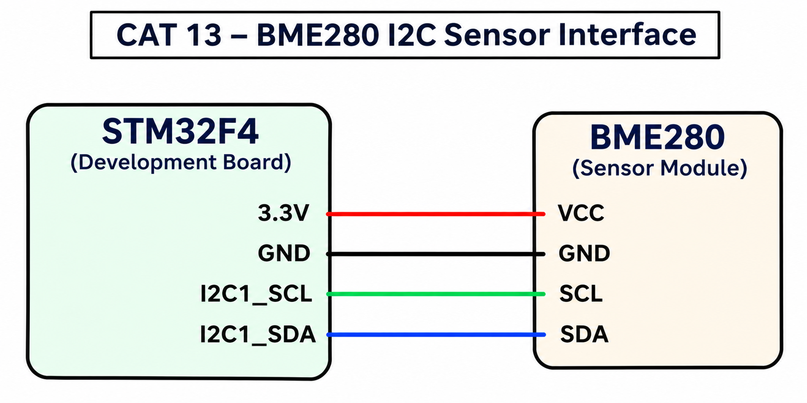

# CAT 13 – BME280 Sensor Interface

**Experiment:** CAT 13

## Experiment Name
Interfacing BME280 Sensor with STM32 using I2C

## Board
STM32F4 Development Board

## Components Used
- STM32F4 Development Board
- BME280 Sensor Module
- Connecting wires

## Communication Protocol
I2C

## Pin Connections

| STM32 | BME280 |
|---|---|
| 3.3V | VCC |
| GND | GND |
| I2C1_SCL | SCL |
| I2C1_SDA | SDA |

## Description
This experiment demonstrates interfacing the BME280 sensor with the STM32 microcontroller using the I2C communication protocol. The sensor measures temperature, atmospheric pressure, and humidity.

## Working
1. Initialize the STM32 peripherals, including I2C1.
2. Configure the BME280 sensor with its I2C address.
3. Initialize the sensor using the BME280 driver.
4. Configure temperature, pressure, and humidity oversampling to 1x.
5. Set the sensor to normal operating mode.
6. Read temperature, pressure, and humidity values from the sensor.
7. Repeat the readings every one second.

## Sensor Configuration
- Temperature oversampling: 1x
- Pressure oversampling: 1x
- Humidity oversampling: 1x
- Filter: Disabled
- Operating mode: Normal

## Circuit Diagram

## HAL and BME280 Functions Used
- `HAL_I2C_Mem_Read()`
- `HAL_I2C_Mem_Write()`
- `HAL_Delay()`
- `bme280_init()`
- `bme280_set_sensor_settings()`
- `bme280_set_sensor_mode()`
- `bme280_get_sensor_data()`

## Source Files
- `Core/Src/main.c`
- `bme280.c`
- `bme280.h`

## Inference
The BME280 sensor is interfaced with the STM32 using I2C communication. The program continuously reads temperature, pressure, and humidity measurements at one-second intervals.