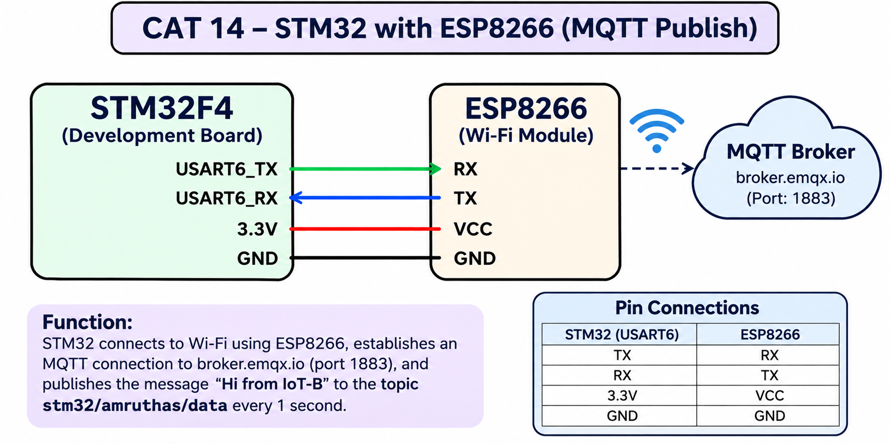

# CAT 14 – STM32 with ESP8266 using MQTT

## Experiment Details

- **Experiment:** CAT 14
- **Name:** MQTT Message Publishing using STM32 and ESP8266
- **Microcontroller:** STM32F4
- **Wi-Fi Module:** ESP8266
- **Communication:** UART
- **MQTT Broker:** broker.emqx.io
- **Port:** 1883

## Objective

To connect the STM32 microcontroller to a Wi-Fi network using the ESP8266 module, establish an MQTT connection with a broker, and periodically publish messages to an MQTT topic.

## Circuit Diagram

## Connections

| STM32 | ESP8266 |
|---|---|
| USART6 TX | RX |
| USART6 RX | TX |
| 3.3V | VCC |
| GND | GND |

## Working

1. Initialize the STM32 peripherals and USART6 communication.
2. Initialize the ESP8266 in Station Mode.
3. Connect the ESP8266 to the Wi-Fi network.
4. Establish a TCP connection with the MQTT broker.
5. Configure the MQTT client and connect to the broker.
6. Publish the message `Hi from IoT-B` to the topic `stm32/amruthas/data`.
7. Repeat the publishing operation every one second.

## MQTT Configuration

| Parameter | Value |
|---|---|
| Broker | broker.emqx.io |
| Port | 1883 |
| Client ID | STM32_Publisher |
| Topic | stm32/amruthas/data |
| Message | Hi from IoT-B |
| QoS | 0 |

## Functions Used

- `ESP8266_Init()` – Initializes the ESP8266 module.
- `ESP8266_wifiConnect()` – Connects to the Wi-Fi network.
- `ESP8266_portConnect()` – Establishes the TCP connection.
- `MQTT_connectBroker()` – Connects the MQTT client to the broker.
- `MQTT_publishTopic()` – Publishes data to the specified MQTT topic.
- `HAL_Delay()` – Provides the one-second publishing interval.

## Inference

The STM32 successfully uses the ESP8266 module for Wi-Fi connectivity and MQTT communication. It publishes the specified message to the MQTT broker at one-second intervals.

