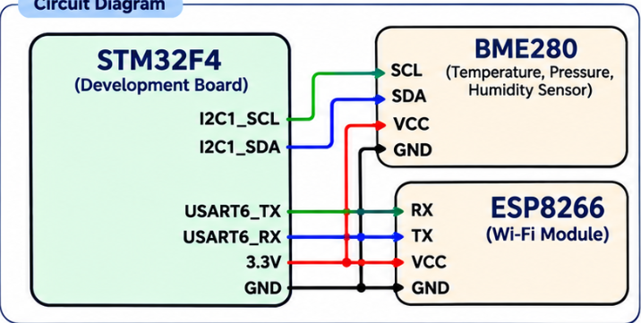

# CAT 15 – BME280 Sensor Data Publishing using MQTT

## Experiment Details

- **Experiment:** CAT 15
- **Name:** IoT Sensor Data Monitoring using BME280, STM32 and ESP8266
- **Microcontroller:** STM32F4
- **Sensor:** BME280
- **Wi-Fi Module:** ESP8266
- **Communication:** I2C and UART
- **MQTT Broker:** broker.emqx.io

## Objective

To interface the BME280 sensor with the STM32 microcontroller, read temperature, pressure and humidity values, and publish the sensor data to an MQTT broker through the ESP8266 Wi-Fi module.

## Circuit Diagram



## Connections

| STM32F4 | BME280 | ESP8266 |
|---|---|---|
| I2C1_SCL | SCL | — |
| I2C1_SDA | SDA | — |
| USART6_TX | — | RX |
| USART6_RX | — | TX |
| 3.3V | VCC | VCC |
| GND | GND | GND |

## Working

1. Initialize the STM32 peripherals, including I2C1 and USART6.
2. Initialize the BME280 sensor using the BME280 library.
3. Configure temperature, pressure and humidity oversampling.
4. Initialize the ESP8266 in Station Mode and connect it to Wi-Fi.
5. Establish a TCP connection with the MQTT broker.
6. Configure the MQTT client and connect to the broker.
7. Read temperature, pressure and humidity values from the BME280 sensor.
8. Format the readings into a JSON message.
9. Publish the JSON message to the MQTT topic every two seconds.

## Sensor Data

The program reads the following parameters:

- Temperature (°C)
- Pressure (hPa)
- Humidity (%)

The sensor readings are formatted into a JSON message:

```json
{
  "temperature": 28.35,
  "pressure": 1008.72,
  "humidity": 62.14
}
```

*The values above are examples; actual readings depend on the sensor and environment.*

## MQTT Configuration

| Parameter | Value |
|---|---|
| Broker | broker.emqx.io |
| Port | 1883 |
| Client ID | STM32_Publisher |
| Topic | stm32/amruthas/data |
| QoS | 0 |
| Keep Alive | 500 |
| Session | Clean Session |
| Publishing Interval | 2 seconds |

## Functions Used

- `bme280_init()` – Initializes the BME280 sensor.
- `bme280_set_sensor_settings()` – Configures sensor settings.
- `bme280_set_sensor_mode()` – Sets the sensor operating mode.
- `bme280_get_sensor_data()` – Reads temperature, pressure and humidity.
- `user_i2c_read()` – Reads data from BME280 registers through I2C.
- `user_i2c_write()` – Writes data to BME280 registers through I2C.
- `ESP8266_Init()` – Initializes the ESP8266 module.
- `ESP8266_wifiConnect()` – Connects the ESP8266 to Wi-Fi.
- `ESP8266_portConnect()` – Establishes the TCP connection.
- `MQTT_connectBroker()` – Connects to the MQTT broker.
- `MQTT_publishTopic()` – Publishes sensor data to the MQTT topic.
- `HAL_Delay()` – Provides the two-second publishing interval.

## Inference

The STM32 reads temperature, pressure and humidity values from the BME280 sensor through I2C, converts the readings into JSON format, and publishes the data to an MQTT broker using the ESP8266 Wi-Fi module.

