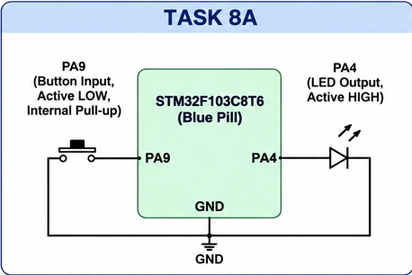

# CAT 8 – GPIO Input/Output

**EXP CAT:** CAT 8  
**TASK:** TASK 8A  
**NAME:** GPIO Input/Output

## Objective
To interface a push button and an LED with the STM32F103C8T6 microcontroller and control the LED based on the button input.

## Hardware and Software Requirements
- STM32F103C8T6 Blue Pill
- Push button
- LED
- STM32CubeMX
- Keil uVision

## Pin Connections

| Component | STM32 Pin | Configuration |
|---|---|---|
| Push Button | PA9 | Input, active LOW, internal pull-up |
| LED | PA4 | Output, active HIGH |

## Circuit Diagram

## Working Principle
- PA9 is configured as a GPIO input with an internal pull-up.
- When the button is not pressed, PA9 reads HIGH.
- When the button is pressed, PA9 reads LOW.
- PA4 is configured as a GPIO output.
- The LED turns ON when the button is pressed and turns OFF when the button is released.

## Algorithm
1. Initialize the HAL library.
2. Configure the system clock.
3. Initialize GPIO pins.
4. Read the button state from PA9.
5. If PA9 is LOW, set PA4 HIGH.
6. Otherwise, set PA4 LOW.
7. Repeat continuously.

## HAL Functions Used
- `HAL_Init()`
- `HAL_GPIO_ReadPin()`
- `HAL_GPIO_WritePin()`
- `HAL_RCC_OscConfig()`
- `HAL_RCC_ClockConfig()`
- `HAL_GPIO_Init()`

## Source Code
`Core/Src/main.c`

## Result
The LED is controlled according to the push-button state. It turns ON when the button is pressed and turns OFF when the button is released.

## Inference
This experiment demonstrates basic GPIO input and output operations using the STM32 microcontroller.
