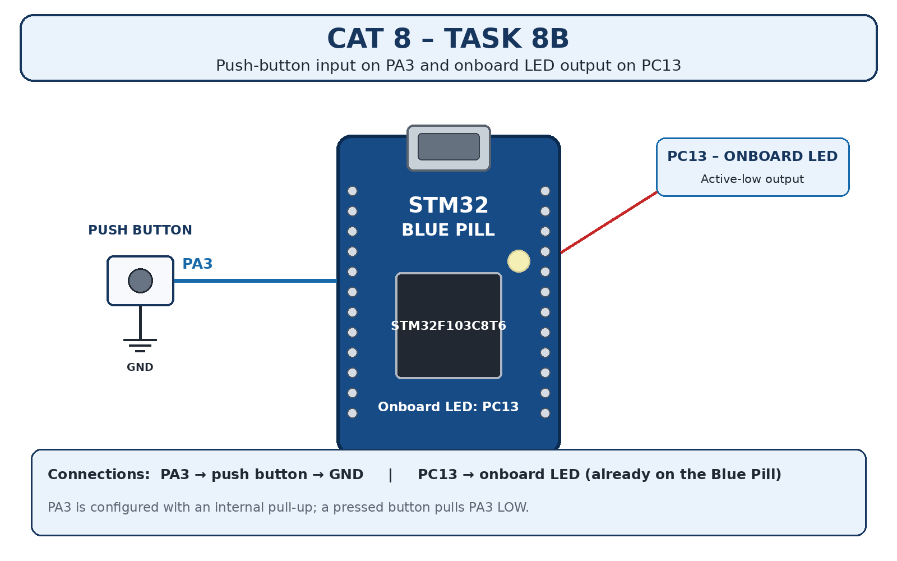

# CAT 8 – STM32 GPIO Bring-Up and Switch-Controlled LED

## EXP
CAT 8 – TASK 8B

## DATE
18/09/2026

## NAME OF EXP
GPIO Input/Output

## HARDWARE SETUP / PLATFORM
- Development Board: STM32F103C8T6 Blue Pill
- Microcontroller: STM32F103C8T6
- Push Button: PA3
- Onboard LED: PC13
- Software: STM32CubeMX and Keil MDK-ARM

## TASK NO
Task 8B

Interface a push-button with the STM32 and control the onboard LED using a debounced button press. Each press toggles the LED state.

## Circuit Diagram

### Pin Connections
- PA3 – Push-button input with internal pull-up.
- PC13 – Onboard LED output (active-low).

## Core Logic / Pseudocode / Code Base

1. Initialize the HAL library.
2. Configure the system clock.
3. Initialize GPIO pins PA3 and PC13.
4. Configure PA3 as input with an internal pull-up.
5. Configure PC13 as output push-pull.
6. Continuously monitor the push-button state.
7. When the button is pressed, wait 20 ms for debouncing.
8. Check the button state again to confirm the press.
9. Toggle the LED state.
10. Wait until the button is released before detecting another press.

### HAL Functions Used
- `HAL_Init()`
- `HAL_GPIO_ReadPin()`
- `HAL_GPIO_TogglePin()`
- `HAL_Delay()`
- `HAL_GPIO_Init()`
- `HAL_RCC_OscConfig()`
- `HAL_RCC_ClockConfig()`

**Source File:** `Core/Src/main.c`

## INFERENCE

Successfully interfaced a push-button with the STM32F103C8T6 Blue Pill. The onboard LED toggles its state with every valid button press. A 20 ms delay is used to reduce the effect of switch bouncing.
