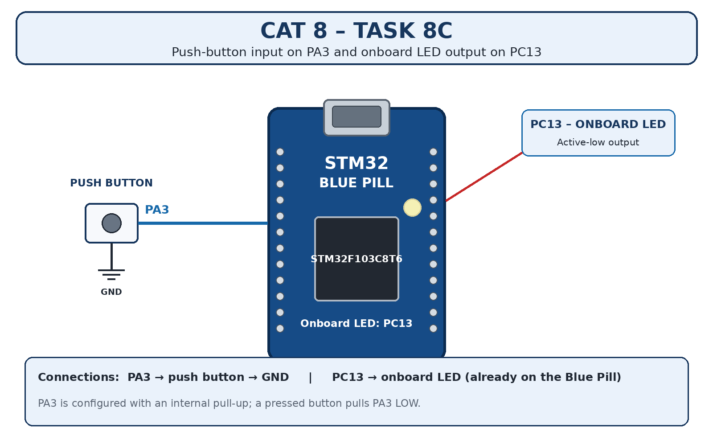

# CAT 8 – STM32 GPIO Bring-Up and Switch-Controlled LED

## EXP
CAT 8 – TASK 8C

## DATE
18/09/2026

## NAME OF EXP
GPIO Input/Output

## HARDWARE SETUP / PLATFORM
- Development Board: STM32F103C8T6 Blue Pill
- Microcontroller: STM32F103C8T6
- Push Button: PA3
- Onboard LED: PC13
- Software: STM32CubeMX and Keil MDK-ARM

## TASK NO
Task 8C

Interface a push-button with the STM32 to control the onboard LED using short-press and long-press detection.

## Circuit Diagram

### Pin Connections
- PA3 – Push-button input with internal pull-up.
- PC13 – Onboard LED output (active-low).

## Core Logic / Pseudocode / Code Base

1. Initialize the HAL library.
2. Configure the system clock.
3. Initialize GPIO pins PA3 and PC13.
4. Configure PA3 as input with an internal pull-up.
5. Configure PC13 as output push-pull.
6. Continuously monitor the push-button state.
7. When the button is pressed, apply a 20 ms debounce delay.
8. Record the button press start time.
9. Wait until the button is released.
10. Calculate the press duration.
11. If the press duration is less than 1000 ms:
    - If blinking is active, stop blinking and turn OFF the LED.
    - Otherwise, toggle the LED.
12. If the press duration is 1000 ms or more, enable blinking mode.
13. Toggle the LED every 500 ms while blinking mode is active.

### HAL Functions Used
- `HAL_Init()`
- `HAL_GPIO_ReadPin()`
- `HAL_GPIO_WritePin()`
- `HAL_GPIO_TogglePin()`
- `HAL_Delay()`
- `HAL_GetTick()`
- `HAL_RCC_OscConfig()`
- `HAL_RCC_ClockConfig()`

**Source File:** `Core/Src/main.c`

## INFERENCE

Successfully interfaced a push-button with the STM32F103C8T6 Blue Pill. Short presses toggle the LED state, while a long press activates blinking mode with a 500 ms interval. A subsequent short press stops blinking and turns OFF the LED.
