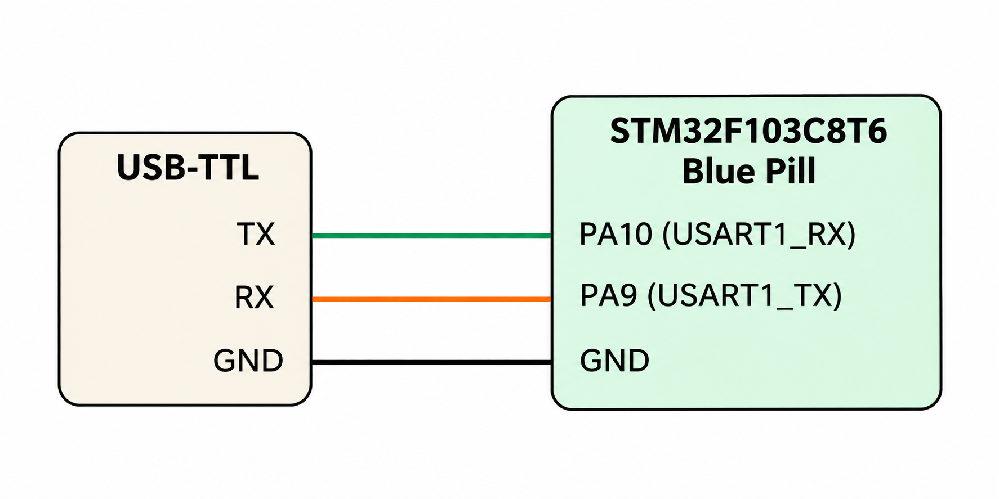

# CAT 9 – UART Communication

**EXP CAT:** CAT 9  
**TASK:** TASK 9A  
**NAME:** UART Communication – Data Reception and Transmission

## Objective
To establish UART communication between the STM32F103C8T6 microcontroller and a USB-TTL converter, receive a character, and transmit the same character back.

## Hardware and Software Requirements
- STM32F103C8T6 Blue Pill
- USB-TTL converter
- STM32CubeMX
- Keil uVision
- Serial terminal software

## Pin Connections

| USB-TTL | STM32F103C8T6 |
|---|---|
| TX | PA10 (USART1_RX) |
| RX | PA9 (USART1_TX) |
| GND | GND |

## Circuit Diagram

## UART Configuration

| Parameter | Configuration |
|---|---|
| UART Peripheral | USART1 |
| Baud Rate | 115200 |
| Word Length | 8 Bits |
| Stop Bits | 1 |
| Parity | None |
| Mode | Transmitter and Receiver |
| Hardware Flow Control | None |

## Working Principle
- USART1 is initialized with a baud rate of 115200.
- The STM32 waits to receive one byte through UART.
- After receiving the byte, the program waits for 1 second.
- The same byte is transmitted back through UART.
- The program waits for another 1 second before repeating the process.

## Algorithm
1. Initialize the HAL library.
2. Configure the system clock.
3. Initialize GPIO and USART1.
4. Wait for one byte of data through UART reception.
5. Store the received byte.
6. Wait for 1 second.
7. Transmit the received byte back through UART.
8. Wait for another 1 second.
9. Repeat continuously.

## HAL Functions Used
- `HAL_Init()`
- `HAL_UART_Receive()`
- `HAL_UART_Transmit()`
- `HAL_Delay()`
- `HAL_UART_Init()`
- `HAL_RCC_OscConfig()`
- `HAL_RCC_ClockConfig()`

## Source Code
`Core/Src/main.c`

## Result
The STM32 receives a byte from the USB-TTL converter and transmits the same byte back after a delay.

## Inference
This experiment demonstrates basic UART serial communication, including data reception and transmission using the USART1 peripheral.
