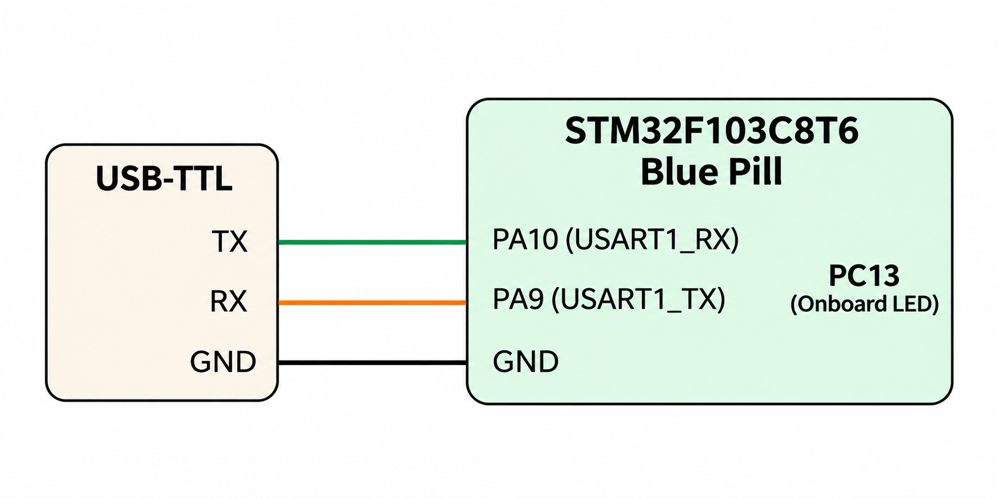

# CAT 9 – UART Communication

**EXP CAT:** CAT 9  
**TASK:** TASK 9B  
**NAME:** UART-Based LED Control Using Commands

## Objective
To control the onboard LED of the STM32F103C8T6 microcontroller using commands received through UART communication.

## Hardware and Software Requirements
- STM32F103C8T6 Blue Pill
- USB-TTL converter
- STM32CubeMX
- Keil uVision
- Serial terminal software

## Pin Connections

| USB-TTL | STM32F103C8T6 |
|---|---|
| TX | PA10 (USART1_RX) |
| RX | PA9 (USART1_TX) |
| GND | GND |

| Onboard Component | STM32 Pin |
|---|---|
| LED | PC13 |

## Circuit Diagram

## UART Configuration

| Parameter | Configuration |
|---|---|
| UART Peripheral | USART1 |
| Baud Rate | 9600 |
| Word Length | 8 Bits |
| Stop Bits | 1 |
| Parity | None |
| Mode | Transmitter and Receiver |
| Hardware Flow Control | None |

## Working Principle
- USART1 is initialized for serial communication at 9600 baud.
- The program displays a command prompt in the serial terminal.
- It receives commands from the user through UART.
- Based on the received command, the onboard LED connected to PC13 is controlled.
- LED control is performed using GPIO operations.
- The LED can also be made to toggle continuously at 500 ms intervals.

## Supported Commands

| Command | Function |
|---|---|
| `LED ON` | Turns the onboard LED ON |
| `LED OFF` | Turns the onboard LED OFF |
| `LED TOGGLE` | Continuously toggles the LED every 500 ms |

The program displays a response for valid commands and an error message for invalid commands.

## Algorithm
1. Initialize the HAL library.
2. Configure the system clock.
3. Initialize GPIO and USART1.
4. Set the onboard LED to OFF initially.
5. Display the UART command interface.
6. Receive characters from the serial terminal.
7. Store the received characters until Enter is pressed.
8. Compare the received command with the supported commands.
9. Execute the corresponding LED operation.
10. Display the response and command prompt.
11. Repeat continuously.

## HAL Functions Used
- `HAL_Init()`
- `HAL_UART_Init()`
- `HAL_UART_Receive()`
- `HAL_UART_Transmit()`
- `HAL_GPIO_WritePin()`
- `HAL_GPIO_TogglePin()`
- `HAL_GetTick()`
- `HAL_RCC_OscConfig()`
- `HAL_RCC_ClockConfig()`

## Source Code
`Core/Src/main.c`

## Result
The onboard LED can be controlled through UART commands. The LED can be turned ON, turned OFF, or made to toggle continuously by sending the corresponding commands through the serial terminal.

## Inference
This experiment demonstrates UART-based command processing and GPIO control using serial communication with the STM32 microcontroller.
